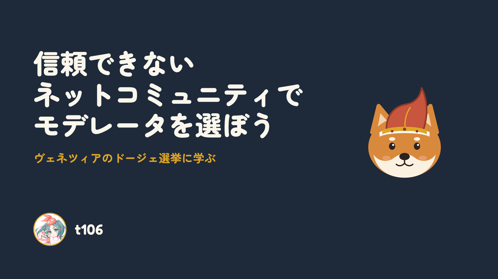

# Doge Election for Communities / コミュニティのためのドージェ選挙

**スライド / Slides:** [信頼できないネットコミュニティでモデレータを選ぼう（PDF）](信頼できないネットコミュニティでモデレータを選ぼう.pdf)

> A proof of concept that picks a neutral representative ("Doge") for small, low-trust online communities by running the 1268 Venetian Doge election protocol, with every approval vote judged by a decision model from members' posts.

[日本語](#日本語) | [English](#english)

# 日本語

信頼し合えない人どうしのネットコミュニティで、みんなが「まあ、この人なら」と言えるモデレータを選ぶ仕組みの試作です。ヴェネツィア共和国が500年以上使ったドージェ選挙を、AIが投票を代行する形で、小さなコミュニティ向けに作り直しました。

## なぜやるのか

ネットには、Redditのサブレディット、ニコニコ動画、ニコニコ大百科のように、あちこちにコミュニティがあります。でも、よく燃えて、よく崩壊します。管理者不在のまま放置されたり、新しいモデレータのやり方に不満が出たりして、ちょっとした対立からコミュニティごと消えてしまうこともあります。

難しいのは、誰にモデレータを任せるかです。メンバー同士が信頼し合っていない場所で多数決をすると、いちばん大きい派閥が勝ち、ほかの派閥の不満がたまります。必要なのは、どの陣営からも許容できる人を選ぶ方法です。

## ヒントはヴェネツィアのドージェ選挙

ヴェネツィア共和国は1268年から1797年まで、元首であるドージェを、くじと信任投票を10段階で交互にくり返して選びました。約480人の大評議会からくじで30人、さらにくじで9人に絞り、その9人が「9人中7人以上の賛成」で40人を選ぶ。これをくり返し、最後に41人がドージェを選びます。

この手続きがうまくいった理由は2つあります。

- **くじ**：最後に誰が投票するか前もって読めないので、買収や根回しが割に合わない。
- **信任投票**：特別多数の賛成が必要なので、一つの派閥だけでは自分たちの候補を通せない。

その結果、みんなが許容できる、いちばん無難な（言ってしまえばつまらない）人が選ばれ続け、この仕組みはナポレオンに滅ぼされるまで500年以上続きました。Mowbray & Gollmann (2007) はこの手続きを分析し、支持の多い候補が有利でありながら少数派にも勝ち目が残ること、段階を重ねると妥協できる候補が浮かび上がることを示しています。

## 発想

ネットのコミュニティも、陣営や推しの利害がぶつかり、お互いを信頼できません。ヴェネツィアの大評議会と同じ「信頼できない評議会」です。それなら、同じ手続きが使えるはずです。ただし、そのままでは持ち込めない点が2つあります。

**投票はAIが代わりにやる。** メンバーに何度も投票を頼むのは現実的ではありません。そこで、各投票の「AさんはBさんの意見に賛成しそうか」を、判定AI（TypeSafe の Jev）が2人の投稿を読んで答えます。メンバーはふだんどおり投稿するだけです。くじで委員を絞ってから判定するので、全員が全員を評価するより手間はずっと少なく済みます。

**手続きを人数に合わせて縮める。** ヴェネツィアの評議会は約480人、ネットのコミュニティは数十人程度です。人数を縮めても「多数派が有利だが、少数派にも勝ち目がある」という勝ち方のバランスが元の手続きに近くなるように、論文の計算モデルで各段階の人数と回数を決めました。50人なら、くじで6人を選び、その6人が12人を選ぶ、を2回くり返し、最後の12人のうち8人以上の賛成でドージェを選びます。

## なぜ真ん中の人が選ばれるのか

人は、自分と考えが近い人に賛成すると考えます。すると、委員会の大多数から賛成を集められるのは、どちらの陣営からも許せる範囲にいる、真ん中の人です。くじと信任投票をくり返すと、委員会そのものが真ん中に寄っていき、最後は考えの真ん中に近い人が選ばれます。

## 試した結果

全員の本当の立場がわかる合成データで試しました。架空のイラスト投稿コミュニティの50人に、AI生成作品の扱いと、講評重視か気軽さ重視かという2つの争点で立場を割り振り、その立場で10件ずつ投稿を書かせたものです。手続きの中では立場を一度も計算せず、投稿だけを使います。

英語版と日本語版で5回ずつ選んだところ、10回とも50人のうち中心寄りの上半分からドージェが選ばれました。中心に近い順の平均は9位で、くじで1人選ぶだけなら平均24位です。中心寄りかどうかは、本当の位置からテューキー深度で計算しています。

| 投稿の言語 | 各回のドージェの順位（50人中） | 平均 |
|---|---|---|
| 英語 | 9, 17, 4, 23, 4 | 11.4位 |
| 日本語 | 8, 4, 4, 7, 10 | 6.6位 |

最も中心にいる2人のうち、苛立った口調で書く1人は一度も選ばれませんでした。AIは意見だけでなく口調にも影響されるようです。口調の悪い人が選ばれにくいのは、モデレータ選びとしてはむしろ自然とも言えます。

## 論文から変えたところ

AIの答えを投票に使うために、元の手続きにない決まりを加えています。

- AIの判定は「賛成しそうな度合い」の数値なので、各段階で中央値以上を賛成とみなします。
- 最終段階だけは、委員が自分自身にも1票入れます。最終委員が、委員以外の候補より不利にならないようにするためです。

## 動かしてみる

`uv`と`make`があれば、プロジェクトのディレクトリで `make run` を実行し、<http://127.0.0.1:8000> を開きます。選出の実行には `.env` に `TYPESAFE_API_KEY` を設定する必要があり、Jev の利用料金がかかります（50人で1回約0.09ドル）。使い方の詳細、合成データの作り方、ファイル構成は [DEVELOPMENT.md](DEVELOPMENT.md)、要件は [REQUIREMENTS.md](REQUIREMENTS.md) にあります。

## 参考文献

- Mowbray, M. & Gollmann, D. (2007). *Electing the Doge of Venice: Analysis of a 13th Century Protocol*. https://rangevoting.org/HPL-2007-28R1.pdf

# English

A prototype for choosing a moderator that everyone in a low-trust online community can live with. It rebuilds the Venetian Doge election, used for over 500 years, for small communities, with an AI casting the votes.

## Why

Online communities are everywhere: subreddits, Niconico, and its wiki Niconico Daihyakka. They also flare up and fall apart easily. Some are left with nobody in charge; in others, members resent how a new moderator runs things. A small dispute can end the whole community.

The hard part is choosing who moderates. Where members distrust each other, a majority vote hands the role to the largest faction and leaves everyone else resentful. What is needed is a way to pick someone every side can tolerate.

## The inspiration: electing the Doge of Venice

From 1268 to 1797, Venice chose its head of state, the Doge, by alternating lotteries and approval votes over ten stages. From a Great Council of about 480, lots picked 30 and then 9. Those 9 chose 40, each needing at least 7 of the 9 approvals, and so on until 41 electors chose the Doge.

It worked for two reasons:

- **Lotteries**: nobody can predict who will vote at the end, so bribery and backroom deals do not pay.
- **Supermajority approval**: no single faction can push its own candidate through.

As a result, Venice kept choosing the most acceptable, safest (frankly, dullest) candidate, and the system lasted over 500 years until Napoleon ended the republic. Mowbray & Gollmann (2007) analyzed the protocol and showed that it favors broadly supported candidates while still giving minorities a chance, and that stacking stages brings compromise candidates to the top.

## The idea

An online community is a low-trust council too: members have factions and favorites, and they distrust each other. The same protocol should work, with two changes.

**An AI casts the votes.** Asking members to vote again and again is unrealistic. Instead, a decision model (TypeSafe Jev) answers each vote, "Would A agree with B's opinions?", by reading both members' posts. Members just post as usual. Because lotteries shrink each committee first, far fewer judgments are needed than having everyone rate everyone.

**The protocol is scaled down.** The Venetian council had about 480 members; online communities have a few dozen. Stage sizes and the number of rounds are chosen with the paper's model so that the balance of winning (the majority is favored, but minorities still have a chance) stays close to the original. For 50 members: draw 6 by lot, those 6 choose 12, repeat once more, and the final 12 pick the Doge with at least 8 approvals.

## Why the middle wins

People approve of those whose views are close to their own. The only candidates who can win a supermajority of a committee are those in the middle, within reach of both sides. Repeating lotteries and votes pulls the committees themselves toward the middle, so the winner ends up near the center of opinion.

## Results

We tested on synthetic data where everyone's true position is known: 50 members of an imaginary illustration-sharing community, placed on two issues (how to treat AI-generated art, and serious critique versus casual fun), each writing 10 posts from that position. The procedure never computes positions; it only reads posts.

Over five runs each with English and Japanese posts, all ten Doges came from the more central half of the 50 members, with a mean rank of 9 by closeness to the center. A lottery alone would average 24. Centrality is the Tukey depth computed from the true positions.

| Posts | Doge's rank in each run (of 50) | Mean |
|---|---|---|
| English | 9, 17, 4, 23, 4 | 11.4 |
| Japanese | 8, 4, 4, 7, 10 | 6.6 |

Of the two most central members, the one who writes irritably was never chosen. The AI seems to respond to tone as well as opinions, which arguably suits choosing a moderator.

## Changes from the paper

To turn the AI's answers into votes, we added rules the original does not have:

- The AI returns a degree of agreement, so in each stage a judgment at or above the median counts as approval.
- In the final stage only, each committee member also counts a vote for themselves, so they are not at a disadvantage against non-members.

Finer rules, such as how unfilled seats are handled, are in [DEVELOPMENT.md](DEVELOPMENT.md) (in Japanese).

## Try it

With `uv` and `make`, run `make run` in the project directory and open <http://127.0.0.1:8000>. Running an election needs `TYPESAFE_API_KEY` in `.env` and uses the paid Jev API (about $0.09 per run for 50 members). Usage details, synthetic-data generation and the file layout are in [DEVELOPMENT.md](DEVELOPMENT.md); requirements are in [REQUIREMENTS.md](REQUIREMENTS.md). Both are in Japanese.

## References

- Mowbray, M. & Gollmann, D. (2007). *Electing the Doge of Venice: Analysis of a 13th Century Protocol*. https://rangevoting.org/HPL-2007-28R1.pdf
